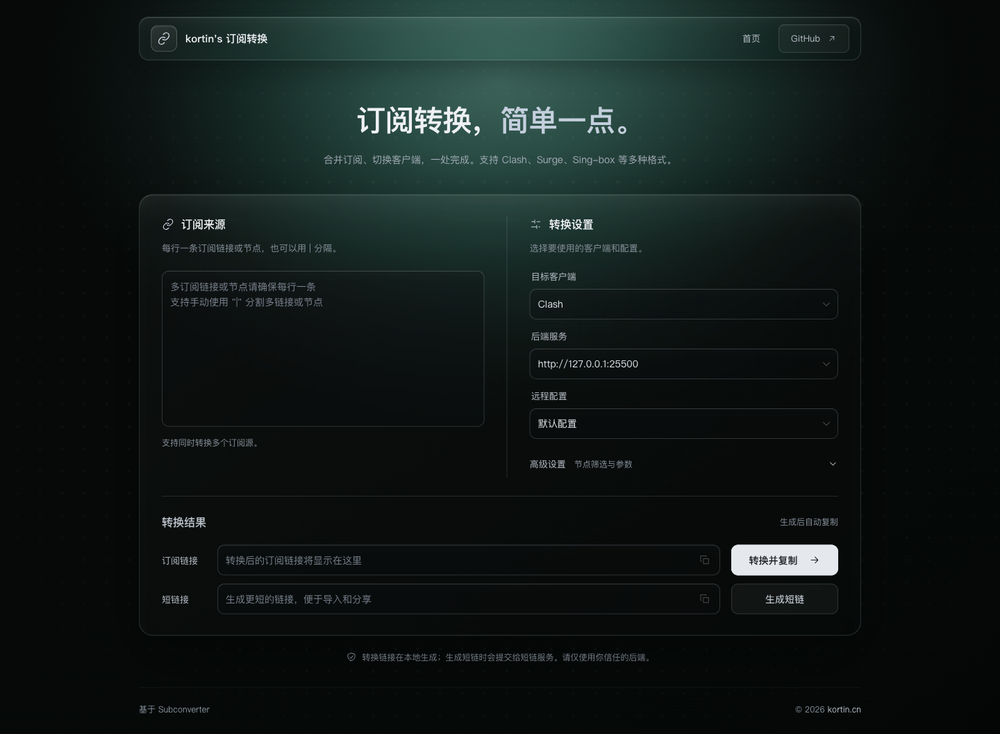
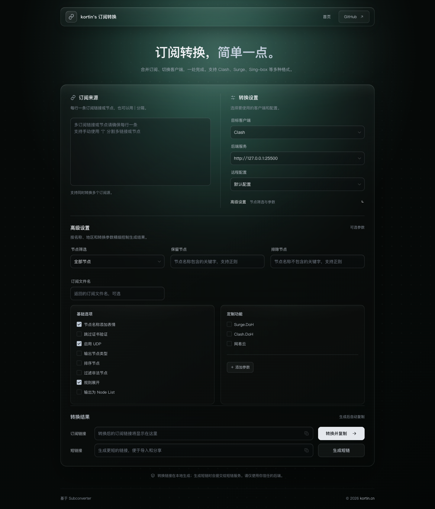

# sub.kortin.cn

一个用于生成多客户端订阅链接的轻量 Web 工具。支持合并多条订阅或节点、选择远程配置、精细筛选节点，并生成可直接导入客户端的订阅地址。

[在线体验](https://sub.kortin.cn) · [GitHub](https://github.com/kortin99/sub.kortin.cn) · [问题反馈](https://github.com/kortin99/sub.kortin.cn/issues)



## 功能

- 支持多订阅链接、节点链接混合输入。
- 支持 Clash、ClashR、V2Ray、Quantumult、Quantumult X、Surge、Surfboard、SS、SSR、Loon、Sing-box 等目标客户端。
- 支持默认后端和自定义 Subconverter 后端地址。
- 支持预设远程配置和自定义远程配置地址。
- 支持按地区、关键字和正则表达式筛选节点。
- 支持 Emoji、UDP、节点排序、规则展开、Node List、DoH 等高级参数。
- 支持自定义查询参数、订阅文件名和节点类型输出。
- 支持一键复制订阅链接和生成短链接。
- 历史记录默认关闭。打开历史抽屉阅读本地存储与密钥提示并主动开启后，使用浏览器 `localStorage` 保存最近 20 条生成记录，支持按日期分组查看、复制、删除和载入配置重新生成。
- 提供桌面端与移动端响应式界面，并适配减少动态效果的系统设置。

### 高级设置



## 工作方式

本项目是纯前端应用，本身不执行订阅转换：

1. 浏览器根据用户输入在本地生成 Subconverter 请求链接。
2. 订阅转换由当前选择的 Subconverter 后端完成；可以使用默认后端，也可以填写自定义 `apiUrl`。
3. 生成短链接时，转换后的长链接会被 Base64 编码并提交给配置的短链接服务。

请只使用你信任的后端和短链接服务。

## 技术栈

| 技术 | 用途 |
| --- | --- |
| Vue 3 | 页面与交互 |
| TypeScript | 类型约束 |
| Vite | 开发服务器与生产构建 |
| Vue Router | 路由 |
| Naive UI | 表单与反馈组件 |
| Axios | 短链接请求 |
| pnpm | 包管理 |

## 本地开发

建议使用 Node.js 22 或更高版本。

```bash
git clone git@github.com:kortin99/sub.kortin.cn.git
cd sub.kortin.cn
pnpm install
pnpm dev
```

开发服务器默认运行在：

```text
http://localhost:8080
```

生产构建：

```bash
pnpm build
pnpm preview
```

构建产物位于 `dist/`。

## 配置

站点配置位于 [public/conf/config.js](./public/conf/config.js)。

```js
window.config = {
  siteName: `kortin's 订阅转换`,
  apiUrl: 'http://127.0.0.1:25500',
  shortUrl: 'https://s.kortin.cn',
  menuItem: [],
  remoteConfigOptions: [],
}
```

| 字段 | 说明 |
| --- | --- |
| `siteName` | 页面左上角显示的站点名称 |
| `apiUrl` | Subconverter 后端地址，默认使用本地 `25500` 端口 |
| `shortUrl` | 短链接服务地址；不使用时仍会生成长订阅链接 |
| `menuItem` | 顶部导航菜单，可配置标题、链接和打开方式 |
| `remoteConfigOptions` | 可选远程配置列表，每项包含 `value` 和 `text` |

修改配置后刷新页面即可生效。

### 自定义 ACL4SSR 规则

仓库提供一份基于 `ACL4SSR_Online_Full.ini` 的自定义远程配置：

```text
rules/
├── ACL4SSR_Custom.ini     # 完整远程配置
├── custom-reject.list     # 自定义拦截规则
├── custom-direct.list     # 自定义直连规则
├── custom-proxy.list      # 自定义代理规则
└── custom-ai.list         # 自定义 AI 分流规则
```

规则优先级为：`custom-reject` → `custom-direct` → `custom-proxy` → `custom-ai` → ACL4SSR 原始规则。
同一个域名不要同时写入多个清单，否则会按上述顺序命中。

`custom-ai.list` 当前是占位清单。它只决定哪些域名进入 `🤖 AI平台`，不会改变该策略组
可选的节点；节点筛选由 `ACL4SSR_Custom.ini` 中 `custom_proxy_group` 的关键词决定。

默认的 `🛑 广告拦截` 聚合了 `custom-reject.list` 和 AWAvenue Ads Rule 的纯广告规则，
不再叠加 ACL4SSR `BanAD.list`，避免重复和扩大误杀。`🍃 应用净化` 继续使用
ACL4SSR `BanProgramAD.list`，因为它可能影响 App 的正常功能，需要保留独立开关。

规则清单使用 Clash 规则格式，不需要在行首写策略组，例如：

```text
DOMAIN,example.com
DOMAIN-SUFFIX,example.com
DOMAIN-KEYWORD,example
IP-CIDR,192.0.2.0/24,no-resolve
```

修改 `.list` 后提交并推送即可。首页的 `ACL4SSR Full + 自定义规则` 预设和
`ACL4SSR_Custom.ini` 都会使用 GitHub raw 地址，Subconverter 后端会直接拉取这些文件，
不需要重新构建前端。

`rules/` 不在 Vite 的 `public/` 目录中，因此不会进入前端构建产物，只通过 GitHub raw
提供给 Subconverter。如果需要额外由站点 `/rules` 提供，需要在 Nginx 或镜像构建时单独复制。

自定义清单在 INI 中设置了 300 秒缓存周期。Subconverter 对外部配置本身还有缓存，
更新后如果暂时没有生效，可以等待几分钟、刷新订阅，或重启后端。客户端也可能缓存订阅内容。

使用 GitHub raw 地址需要同时满足：

- 仓库公开，分支和路径与配置中的 URL 一致。
- 当前 Subconverter 后端能够访问 `raw.githubusercontent.com`。
- 不能使用 GitHub 网页的 `blob` 地址，必须使用原始文件地址。

如果后端访问 GitHub 不稳定，可以将这些文件改为通过 `https://sub.kortin.cn/rules/...`
提供，并同步修改 `config.js` 和 `ACL4SSR_Custom.ini` 中的地址。使用 `main` 分支时，
每次推送都会影响后续生成的订阅；需要可复现配置时应改用 tag 或 commit URL。

### 短链接接口

前端会向 `${shortUrl}/short` 发起 `POST` 请求：

```text
Content-Type: multipart/form-data
longUrl=<Base64 编码后的订阅链接>
```

成功响应格式：

```json
{
  "Code": 1,
  "ShortUrl": "https://example.com/abc"
}
```

## Docker 部署

镜像内置 Subconverter 与 Nginx。

快速启动：

```bash
docker run -d --name subweb --restart always \
  -p 18080:80 \
  kortin99/sub.kortin.cn:latest
```

访问 `http://127.0.0.1:18080`。

挂载自定义配置：

```bash
docker run -d --name subweb --restart always \
  -p 18080:80 \
  -v /path/to/public/conf:/usr/share/nginx/html/conf \
  kortin99/sub.kortin.cn:latest
```

也可以通过环境变量覆盖后端地址和短链接地址：

```bash
docker run -d --name subweb --restart always \
  -p 18080:80 \
  -e API_URL=https://sub.example.com \
  -e SHORT_URL=https://s.example.com \
  kortin99/sub.kortin.cn:latest
```

站点名称、导航和远程配置列表请通过挂载 `config.js` 修改。生产环境建议使用 Nginx 或其他反向代理提供服务。

自行构建镜像：

```bash
docker build --no-cache -f docker/Dockerfile -t kortin99/sub.kortin.cn:latest .
```

### 一键部署（前端 + Subconverter + 短链）

仓库提供独立的 `docker/compose.yaml`，会启动四个服务：

- `web`：构建并托管前端，同时作为统一入口反向代理其他服务。
- `subconverter`：使用 MetaCubeX 官方镜像。
- `myurls`：使用 `stilleshan/myurls` 短链镜像，并将短链数据保存在 Redis 中。
- `redis`：为 `myurls` 提供持久化存储。

短链部分参考 [stilleshan/sub](https://github.com/stilleshan/dockerfiles/tree/main/sub) 的 Compose
部署方式，底层项目为 [CareyWang/MyUrls](https://github.com/CareyWang/MyUrls)。本仓库没有直接使用
`stilleshan/sub` 聚合镜像，因为它包含旧版前端，会覆盖当前仓库构建的前端。

```bash
cd docker
cp .env.example .env
docker compose up -d --build
```

默认访问 `http://localhost:18080`。如果通过域名或反向代理访问，必须把 `.env` 中的前端地址和
短链地址改为浏览器实际访问的协议与域名，例如：

```dotenv
PUBLIC_PROTO=https
PUBLIC_HOST=sub.example.com
SHORT_PROTO=https
SHORT_HOST=s.example.com
```

当前固定的 `stilleshan/myurls:2024-05-02` 镜像内置 365 天短链有效期。上游文档提到的
`MYURLS_TTL` 没有被该镜像的启动脚本传入程序，因此修改这个环境变量不会生效。

入口 Nginx 将 `/short` 和 `/<7位字母数字短码>` 代理给 MyUrls，并为 `/short` 返回 CORS 响应头。
默认同源部署时无需额外反向代理；使用独立短链域名时，需要把两个域名都反代到 `web` 的 `80` 端口。
同源部署时不要新增与“7 位字母数字”冲突的前端单层路由。

查看状态和日志：

```bash
docker compose ps
docker compose logs -f web myurls redis
```

停止服务：

```bash
docker compose down
```

同时删除 Redis 中的短链数据：

```bash
docker compose down -v
```

> `stilleshan/myurls` 会把长链接以明文保存在 Redis 中，并接受任意目标 URL。当前 Compose 只在入口
> 层做了创建限流，没有目标域名白名单。若用于公开服务，应限制创建入口，或基于 MyUrls 源码增加
> 域名白名单、鉴权和数据加密。

### docker 发布
```shell
docker push kortin99/sub.kortin.cn:latest
docker push kortin99/sub.kortin.cn:v0.0.1
```

### 删除本地镜像
```shell
docker images | grep sub.kortin.cn
docker rmi kortin99/sub.kortin.cn
```

## 项目结构

```text
.
├── docker/
│   ├── .env.example             # Compose 部署环境变量示例
│   ├── nginx/                    # Compose 部署的 Nginx 配置模板
│   ├── web/                      # 前端镜像与运行时配置脚本
│   ├── Dockerfile                # 已发布的全能镜像
│   ├── compose.yaml              # 前端 + Subconverter + 短链一键部署
│   └── start.sh                  # 全能镜像启动脚本
├── docs/                         # README 截图
├── public/
│   └── conf/config.js            # 站点配置
├── rules/                        # 自定义 ACL4SSR 配置与规则清单
├── src/
│   ├── assets/                   # 全局样式
│   ├── components/               # 通用组件与业务组件
│   ├── composables/              # 订阅转换、反馈和导航逻辑
│   ├── layouts/                  # 页面布局
│   ├── network/                  # HTTP 请求封装
│   ├── router/                   # 路由配置
│   └── views/                    # 页面
├── vite.config.ts
└── package.json
```

## 安全提示

- 生成订阅链接时，浏览器只在本地拼接请求地址，不会自动上传输入内容；使用生成的链接时，当前选择的 Subconverter 后端会收到其中的源订阅地址。项目支持默认后端和自定义后端，请只选择你信任的服务。
- 生成短链接时，完整转换链接会经 Base64 编码后提交给目标短链接服务；Base64 不是加密。
- 历史记录只保存在浏览器 `localStorage`，不会上传到服务器。记录可能包含订阅密钥，请避免在公用设备上启用，并及时清理。
- “跳过证书验证”会降低连接安全性，仅在确认需要时开启。

## 许可

本项目使用 [GNU General Public License v3.0](./LICENSE)。
